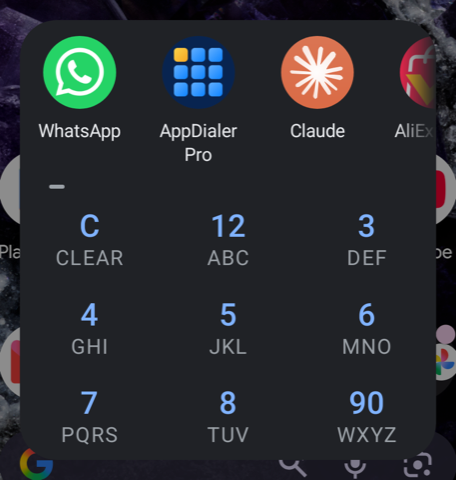
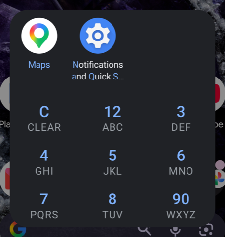
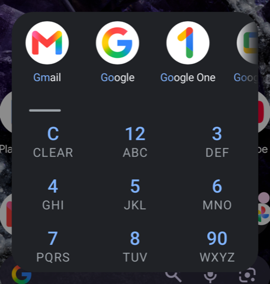
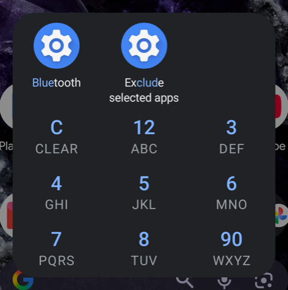

# T9 App Launcher

A tiny Android app launcher that does one thing: find an app (or a settings page) with a T9 keypad and open it.

| Recent apps | `6277` → Maps | `46` → **G**mail, **Go**ogle… | `2583` → Bluetooth settings |
|---|---|---|---|
|  |  |  |  |

I used [AppDialer](https://play.google.com/store/apps/details?id=name.pilgr.appdialer.pro) for years in place of the
assistant. It is not maintained any more, so I wrote this replacement. It keeps only the T9 search (apps and settings
pages) and focuses on speed, size and a small RAM and CPU footprint.

- About 28 KB APK. Plain Java, no libraries, no AndroidX.
- The whole UI is one custom `View`: no layouts, no adapters.
- Drawn in software: for a panel this small it is faster than starting a GPU context and uses far less memory.
- On my Pixel 8: opens in about 40 ms when the process is warm and 100 ms from cold, with about 19 MB of RAM (see
  [Performance](#performance)).
- The app list and the icons are cached on disk, so results show at once, even on a cold start.
- The app list is only rescanned when Android reports a package change. That check runs in the background on every
  open, so it never delays the panel. The rescan itself runs in a separate, short-lived process: reading every app's
  name loads their files (70–130 MB for about a second), and that memory is given back as soon as the scan ends.
- Only the icons on screen are loaded, on their own thread, so a rescan never delays them. At most 48 stay in memory. When the panel closes, it keeps the icons of my 8 most recent apps, so the next open draws them at once.
- No permissions, no network.

## Performance

Measured on my Pixel 8 (Android 17): the median of 8 cold and 8 warm opens, with `am start -W` for the time and
`/proc/<pid>/stat` for the CPU time; RAM is the PSS from `dumpsys meminfo`.

| | AppDialer Pro 7.5.1 | T9 App Launcher 1.0.0 | T9 App Launcher 1.1.0 | T9 App Launcher 1.2.0 | T9 App Launcher 1.6.0 |
|---|---:|---:|---:|---:|---:|
| APK size | 2,203 KB | 21 KB | 23 KB | 26 KB | 26 KB |
| Cold open, time | 124 ms | 105 ms | 96 ms | 93 ms | 103 ms |
| Cold open, CPU time | 250 ms | 170 ms | 50 ms | 50 ms | 50 ms |
| Warm open, time | 61 ms | 54 ms | 42 ms | 35 ms | 38 ms |
| Warm open, CPU time | 90 ms | 30 ms | 20 ms | 20 ms | 20 ms |
| RAM while open | 119 MB | 36 MB | 18 MB | 18 MB | 19 MB |
| RAM after close | 57 MB | 22 MB | 19 MB | 21 MB | 22 MB |

"Cold" means the process was not running; "warm" means it was still in memory.

For comparison, an empty app that only shows the same card: cold 93 ms, warm 44 ms, 9 MB while open, 13 MB after
close. So almost all of the open time is Android's own work.

## How it works

- Type with the keypad (`2`–`9`). As on AppDialer, `1` shares the `2` key and `0` the `9` key, so digits in names
  match too (`299` → Radio **100**). `C` clears. Back, or a tap outside the panel, closes it.
- An app or settings page matches when the keys match:
  - the start of its name (`432` → **Hea**rts),
  - the start of any word (`6277` → Google **Maps**),
  - the starts of its words in order, from the first word, none skipped (`46` → **G**oogle **M**aps,
    `476` → **G**oogle **P**lay **M**usic), or
  - any part of one word (3 or more keys: `2583` → Ex**clud**e).
- Words also start at capitals inside a name (`8823` → You**Tube**, `8439` → PDF**View**er). Accents and special
  letters count as their plain letters (`38772` → **Fußb**all, `67378` → **Øresu**nd, `fi` as `fi`).
- The matched letters are shown in blue.
- What I opened most recently from here comes first; then the best matches, apps before settings pages.
- Tap a result to open it. Long-press an app to open its App info. T9 App Launcher lists itself too, so its App info is one long-press away (a tap just closes the panel).
- Apps from the work profile are included.
- Settings pages are searchable too, read from the phone's own Settings app: every page it lets other apps open, with
  its translated title (about 160 on my Pixel 8). Pages that need an app to be chosen first are left out. The words of
  the page's internal class name count too, but only when one of them starts with what you typed: Pixel titles the
  Bluetooth page "Devices", but `blue` finds it and shows it as **Blue**tooth. Settings pages appear in the empty panel only once you used them.
- Long names wrap to a second line between words when the rest then fits; otherwise at any character, so as much of
  the name as possible is shown.

## Open it with the assistant gesture

The activity handles `android.intent.action.ASSIST`, so Android offers it as a digital assistant app.

Settings → Apps → Default apps → Digital assistant app → **T9 App Launcher**.

The assistant gesture (swipe up from a bottom corner, or long-press home) then opens it. Until it is set, the app
shows a bar on top that opens this settings page (tap ✕ to hide it).

If the corner swipe does nothing, check that the gesture is on. On Pixel: Settings → System → Gestures → Navigation
mode → ⚙ → Swipe to invoke assistant.

With adb:

```sh
adb shell cmd role add-role-holder android.app.role.ASSISTANT com.dbuezas.t9launcher 0
```

## Download

Get the APK from [Releases](../../releases). Every push to `main` also builds an APK in GitHub Actions (see the
workflow artifacts).

## Build

```sh
./gradlew assembleRelease   # app/build/outputs/apk/release/app-release.apk
./pair.sh 123456            # pair once: only the code from "Pair device with pairing code"
./connect.sh                # find the phone over wireless adb (mDNS)
./install.sh                # build and install on the connected device
scripts/screenshots.sh      # retake the README screenshots on the phone
scripts/bench.sh            # cold/warm open time, CPU time and RAM (median of 8 each)
scripts/release-notes.sh v1.7.0  # release notes: the commits since the previous tag (CI uses it)
```

Release signing reads `keystore.properties` (gitignored) or the `KEYSTORE_FILE`, `KEYSTORE_PASSWORD`, `KEY_ALIAS` and
`KEY_PASSWORD` environment variables. Without them, the release build uses the debug key.

## License

MIT
